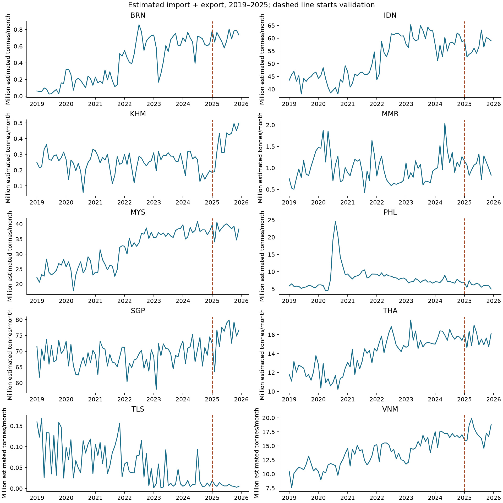
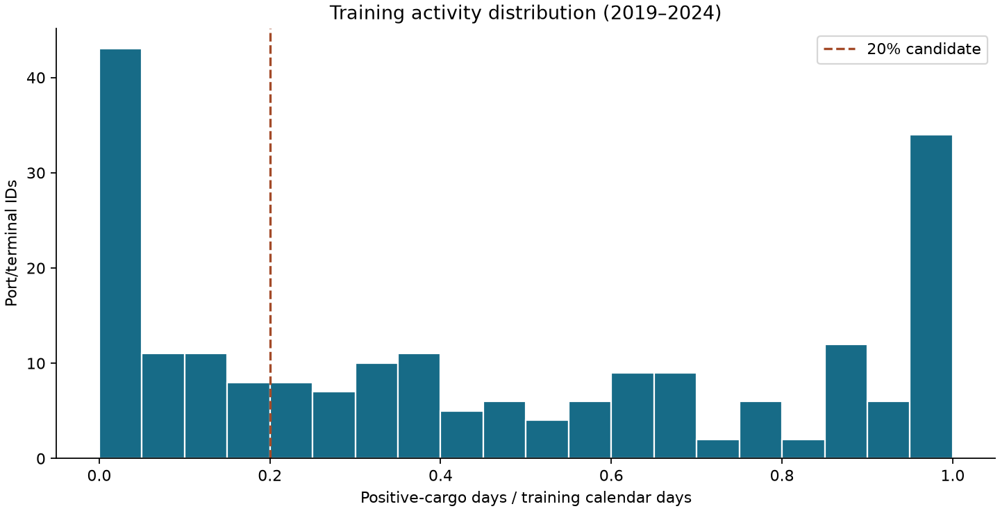
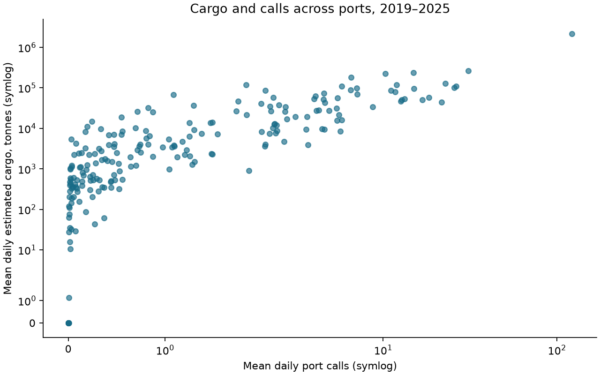

# Data and Exploratory Analysis

## Data source, coverage and preparation

We use a fixed IMF PortWatch snapshot distributed through the Humanitarian Data Exchange (HDX), obtained and verified locally on 18 October 2026. It contains 594,720 daily observations for 210 port or terminal identifiers in ten coastal Southeast Asian countries, from 1 January 2019 through 2 October 2026. Lao PDR is part of the broader eleven-country proposal but is outside the core coastal-port forecasting panel. The snapshot is not verified as byte-identical to an earlier group download. Stable source URLs, file hashes, recorded download/verification times and terms are preserved in the source manifest. The multi-file SHA256 is `fb4eee5b71de5692334abc45fadbee522fc32572e30ded15f2e6daeade137070`.

The outcome is estimated cargo in metric tonnes, defined as the sum of the published import and export aggregates. Category subtotals are not added again. The source has 29 columns; the canonical panel contains date, port identifier, country code, imports, exports, port calls and total cargo. The accompanying data dictionary specifies all mappings, units, allowed values and missing-value rules. Port/terminal names are metadata, not keys; 44 identifiers have source names containing Offshore Oil Terminal and are not silently treated as conventional ports.

Preparation verifies unique port–date keys, consistent countries, midnight UTC observation labels, numeric validity and daily-calendar coverage. The audit found no duplicate keys, absent calendar records, missing source measurements or negative/nonfinite numeric values. All 594,720 original observations are retained. Unknown values would remain missing and prevent complete-window construction rather than being filled with zero. Published shipment aggregates differ from component sums by at most four tonnes in this snapshot; the published totals are retained and the discrepancy is documented without assuming an unverified cause.

PortWatch quantities are estimates rather than measured terminal throughput or capacity; their limitations and revisions are discussed by [Arslanalp et al. (2025, section 2)](https://www.imf.org/-/media/files/publications/wp/2025/english/wpiea2025093-print-pdf.pdf). The daily timestamp is an observation label, not evidence that the value was available at that instant.

## Zero observations and activity heterogeneity

Of the 594,720 known-cargo observations, 322,534 are zero (54.2329%). Positive port calls occur on 30,228 of these days (9.3720% of zero observations). Thus, a reported zero cargo estimate cannot automatically be interpreted as absence of vessel activity. We identify 1,173 contiguous zero runs of at least 28 days across 97 identifiers; 622 runs contain positive calls. These are investigation flags rather than confirmed reporting gaps. Runs touching snapshot boundaries are censored. Eight identifiers have zero cargo throughout the snapshot, seven with offshore-oil-terminal source names; no eligibility decision uses that full-snapshot information.

| Country | Port/terminal IDs | Daily observations | Zero-cargo share (%) |
|---|---:|---:|---:|
| Brunei Darussalam | 2 | 5,664 | 59.45 |
| Cambodia | 1 | 2,832 | 9.60 |
| Indonesia | 101 | 286,032 | 53.58 |
| Malaysia | 41 | 116,112 | 56.18 |
| Myanmar | 2 | 5,664 | 50.81 |
| Philippines | 26 | 73,632 | 65.31 |
| Singapore | 3 | 8,496 | 1.11 |
| Thailand | 13 | 36,816 | 53.01 |
| Timor-Leste | 3 | 8,496 | 91.56 |
| Viet Nam | 18 | 50,976 | 43.24 |

The pooled zero proportion conceals large country differences. Counts in this table describe the full snapshot only; they do not determine modelling eligibility. For decision-related plots we use training/validation data through 2025. Monthly sums describe estimated cargo activity and must not be interpreted as official customs trade or measured capacity utilisation.

*Figure 1. Monthly published import-plus-export totals by country, 2019–2025. The dashed line marks validation; panel scales differ. No test-period trend is used to choose a rule.*

*Figure 2. Positive-cargo share of the 2,192 training calendar days per port. The 20% line is a candidate eligibility threshold, not a data-cleaning rule.*

*Figure 3. Port-level means of daily estimated cargo and calls, 2019–2025. Symmetric-log scales retain zeros. This association does not establish causation or diagnose an individual zero.*

## Controlled evaluation of zero handling

The agreed chronological periods are training 2019–2024, validation 2025 and reserved test 1 January–2 October 2026. For each origin t, the prediction target is the original estimated cargo total over t+1,…,t+7. Inputs are the prior seven-day cargo total, prior seven-day calls and prior 28-day mean cargo, each ending at t. Target windows remain entirely within their assigned period. Models, preprocessing and activity groups use training data only; test-period measurements are discarded before constructing this diagnostic's features and labels.

We compare retaining observed zeros, removing zero-total training labels, and replacing zero predictor-history values with the mean of positive observations over the preceding 28 calendar days (falling back to zero when no positive history exists). Replacement is causal and changes predictors only, never evaluation labels. Deleting daily zero rows is not a valid alternative because it changes a seven-calendar-day horizon into seven surviving observations. Pooled ordinary least squares with the protocol's three inputs provides a fixed diagnostic, with train-fitted scaling and consistently nonnegative primary predictions. Unclipped predictions and seasonal naïve are sensitivity/reference results. This exploratory Task 1 analysis supports joint review rather than replacing Task 2's production baseline comparison.

Every main policy is evaluated on the same 75,390 validation origins across 210 ports, including 20,458 zero-total and 54,932 positive-total windows. Retention and replacement each use 453,180 training origins. Dropping zero training labels removes 124,657 origins and leaves nine ports without any training labels, while all 210 ports remain in evaluation.

| OLS treatment | MAE (tonnes) | RMSE (tonnes) | WAPE (%) | Zero-target MAE | Positive-target MAE |
|---|---:|---:|---:|---:|---:|
| Retain observed zeros | **41,100.62** | **101,217.66** | **17.7280** | **4,505.64** | **54,729.47** |
| Drop zero-total training labels | 41,699.90 | 101,247.46 | 17.9865 | 6,375.20 | 54,855.67 |
| Replace zero predictor history | 60,426.61 | 128,710.84 | 26.0639 | 35,581.01 | 69,679.71 |

Relative to retention, dropout increases MAE by 1.46% and replacement by 47.02%. Original-history seasonal naïve has MAE 51,627.80 tonnes; replacing its zero history raises MAE to 80,696.83 tonnes. An always-zero reference has MAE 231,840.54 tonnes, so the zero-heavy dataset does not make a trivial zero forecast competitive overall. WAPE is undefined for the all-zero target subset; its errors remain included in pooled WAPE. Per-port, country and training-activity results are supplied alongside pooled scores. Macro-port MAE equals pooled MAE in this balanced panel.

*Figure 4. Same-row validation MAE for nonnegative OLS forecasts. Each panel uses the same cohort across treatments; target-stratum panels have different vertical scales.*

Retention has lower MAE than both interventions in all seven non-overlapping origin phases and in each training-activity group. Country exceptions remain: dropout improves Cambodia's MAE and replacement improves Timor-Leste's MAE. We do not tune country-specific rules from these exceptions or claim universal dominance.

Because daily seven-day labels overlap, conventional independent-row uncertainty estimates are inappropriate. A paired moving-block bootstrap resamples dates with all ports moving together, using 28-day blocks, 2,000 replicates and seed 42. The MAE-difference intervals (alternative minus retention) are [580.38, 618.88] tonnes for dropout and [17,836.41, 20,610.17] for replacement. The directions persist with 7/56-day blocks and unclipped forecasts. These descriptive intervals are conditional on the fitted models, selected population and single validation year; they exclude retraining and measurement uncertainty and are not confirmatory evidence about future periods.

## Training-only port selection and handoff

All 210 IDs have complete training cargo/call coverage. The 20% positive-training-day candidate retains 137 IDs and all ten countries, removing 73 IDs (34.76%). On the **same 49,183 origins across those 137 IDs**, active20 training slightly improves nonnegative OLS MAE from 58,959.33 to 58,943.54 tonnes (0.0268%), while RMSE increases. This cannot be compared directly to the 210-port MAE because the populations differ, nor does it establish accuracy for excluded ports.

The Task 1 handoff recommends retaining all complete-training-coverage ports and their observed zeros, preserving geographical coverage while keeping the 20% rule as a documented sensitivity. This explicitly forgoes a small common-cohort MAE gain rather than claiming the broad cohort minimises that score. Training-defined activity groups use fixed boundaries at one-third and two-thirds positive calendar days: 96 low-, 47 medium- and 67 high-activity IDs. Selection statistics and reasons accompany every ID. This recommendation and the shared population must be reviewed jointly with Task 2 before final freezing.

## Interpretation and limitations

The evidence supports preserving published zeros for this seven-day pooled-OLS validation design and argues against blanket zero deletion or replacement. It does not prove that each zero is physically correct, that all imputation approaches fail, or that RF/HGB will prefer the same modelling choices. No independent vessel-level or port-operation evidence is available to resolve suspected reporting anomalies. The clean panel therefore retains original observations and documents flags without fabricating corrections.

Origin-level release timestamps and historical vintages are unavailable. The evaluation is a retrospective same-day-availability scenario, not a verified real-time backtest. Future operational use needs an agreed information lag or archived release vintages. The reserved test set has not been scored; final model conclusions await the group's frozen comparison. Estimated cargo forecasts may inform demand planning, but do not themselves establish terminal capacity, congestion, utilisation or monetary savings.

Reproducible evidence: `results/data_audit.md`, `results/zero_validation.md`, `results/zero_policy_metrics.csv`, `results/paired_block_sensitivity.csv`, the data dictionary and source manifest. Detailed experimental definitions and qualifications are in `docs/zero_handling.md`.
