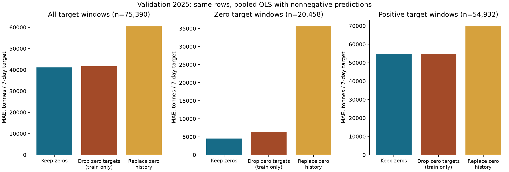

# Zero-cargo handling: design, evidence and handoff decision

Owner: Nguyễn Thị Quỳnh Hân. Task 1 validation diagnostic, 27 October 2026. The implementation and empirical analysis are complete; joint Task 2 review and the shared rule freeze remain pending. Hân confirmed that Định and Hiếu have no additional validation code/results or port rules yet, and requested this evaluation under the repository protocol.

## What the comparison can answer

The question is whether automatic removal or replacement of published zeros helps predict the next **seven calendar days of published estimated cargo**. It is not whether each zero is a true physical absence of cargo: that would require independent port/vessel evidence unavailable in this snapshot. An observed zero remains a known value; an absent record or unknown measurement remains missing. The clean panel is never modified by the experiments.

The audit finds 322,534 zero-cargo port-days (54.2329%), including 30,228 with positive calls, and 1,173 runs lasting at least 28 days. Of those long runs, 622 contain calls. These patterns motivate investigation but cannot establish closure, AIS failure or a reporting gap. Eight IDs have zero cargo throughout the snapshot; seven have source names containing Offshore Oil Terminal. They remain in the audit, and their full-snapshot status is not used for selection. The IMF describes revision, reception and shipment-estimation limitations; these support caution, not a row-level diagnosis ([Arslanalp et al., 2025, section 2](https://www.imf.org/-/media/files/publications/wp/2025/english/wpiea2025093-print-pdf.pdf)).

Deleting zero **days** before rolling windows is invalid for this target: seven surviving rows can span more than seven calendar days. Among 205,872 eligible positive-origin training windows, 52.7303% would exceed seven calendar days; the median span is eight days and the maximum is 1,880. This conditional illustration is recorded in `results/zero_calendar_distortion.csv`; it is not a comparable forecast score. Instead, the controlled deletion experiment below removes only zero-total training labels after correctly constructing calendar windows.

## Design recorded before the new run

The dates were previously confirmed by Hân as agreed with Định and Hiếu: train 2019–2024, validation 2025, test 2026-01-01–2026-10-02. `experiment.json` records the new diagnostic design. This is an exploratory validation study; an earlier, archived comparison of the 20% rule had already been seen, so it is not an independent preregistration or untouched confirmatory experiment.

At origin t, the three inputs are cargo sum and calls sum over t−6…t, and mean cargo over t−27…t. The label is the sum over t+1…t+7. Training labels end by 2024-12-31; validation origins run from 2024-12-31 to 2025-12-24, with labels entirely in 2025. The first 27 training days lack a 28-day history; origins whose labels cross the train boundary are excluded. No measurements after 2025-12-31 enter any feature, label, model fit, policy comparison or forecast score.

We fit pooled ordinary least squares (OLS) with an intercept and the protocol's three inputs. Feature centring/scaling is fitted on each policy's training rows only. Models are not refitted during validation, although observed history through the current origin is used. Primary forecasts are bounded below by zero consistently across policies; because the target is nonnegative, this is a prespecified domain constraint. Unclipped forecasts are reported as a sensitivity, not silently discarded. The shared final clipping choice remains unset pending review.

| Policy | Training treatment | Validation treatment |
|---|---|---|
| `retain_zero` | All complete windows, original zeros retained | Original predictors and labels |
| `drop_zero_targets` | Remove only windows with original seven-day label equal to zero | Same evaluation keys and original labels, including zeros |
| `replace_zero_history` | For a zero on date d, use the mean of **observed positive** cargo on d−28…d−1, or 0 if none; change predictor history only | Apply the same strictly past-only rule; original labels remain unchanged |
| `active20` | Retain ports with >=20% positive-cargo training calendar days and complete training cargo/call coverage; retain all their zero days | Compare against retain-zero training on the common 137-port cohort |

The replacement diagnostic is a deliberately specified sensitivity to treating zeros as suspect, not an endorsed estimate of missing physical shipments. It never uses future positive values, recursively imputed values, other ports or the target period. Unknown values are not replaced. The dropout diagnostic is outcome-selected training and may induce selection bias; it is not equivalent to dropping zero daily rows.

Seasonal naïve predicts the last seven-day total. Its original-history and replaced-history variants provide a model-independent check of the replacement effect. An always-zero forecast is a reference to reveal whether many zero targets can make trivial forecasts look favourable.

## Fixed evaluation populations and exclusions

For the main zero-policy comparison, every model uses **75,390 identical origins, 210 ports × 359 dates**: 20,458 zero-total windows and 54,932 positive-total windows. Both countries and training-defined activity groups remain fixed. All three policies have the same complete-window mask. IDs and dates are checked for uniqueness and alignment before scoring.

| Policy | Training origins | Excluded from 453,180 complete training origins | Training ports | Zero training labels |
|---|---:|---:|---:|---:|
| Retain zero | 453,180 | 0 | 210 | 124,657 |
| Drop zero targets | 328,523 | 124,657 | 201 | 0 |
| Replace zero history | 453,180 | 0 | 210 | 124,657 |
| Active20 | 295,646 | 157,534 | 137 | 10,982 |

Dropout eliminates every training label for nine ports, although those ports stay in validation. This is a consequence of that policy and is explicitly exposed rather than removing their evaluation rows. For active20, the paired comparison is **49,183 identical origins across 137 ports**. It excludes 73 ports and 26,207 validation origins from that sensitivity cohort. It cannot establish performance for the excluded low-activity ports.

`validation_keys.csv`, `window_exclusions.csv`, `training_exclusions_*.csv` and the prediction file remain local because of size. Compact exclusion counts, country retention and all 210 port-rule reasons are supplied in the reviewed result tables. Missing-window exclusions are determined from original data, never separately per policy. The current snapshot has no missing measurement windows beyond initial history and period boundaries.

## Main results: original targets on all 210 ports

MAE and RMSE are tonnes per seven-day target. WAPE is a percentage of total actual cargo; zero-actual errors remain in its numerator. Macro-port MAE equals pooled MAE here because each port has the same 359 evaluation dates; this does not remove the influence of high-tonnage ports. Positive bias means overprediction.

| Treatment / model | MAE | RMSE | WAPE (%) | Mean bias |
|---|---:|---:|---:|---:|
| Retain zero / OLS, nonnegative | **41,100.62** | **101,217.66** | **17.7280** | 302.23 |
| Drop zero targets / OLS, nonnegative | 41,699.90 | 101,247.46 | 17.9865 | 2,073.20 |
| Replace zero history / OLS, nonnegative | 60,426.61 | 128,710.84 | 26.0639 | 12,279.80 |
| Retain zero / seasonal naïve | 51,627.80 | 128,402.46 | 22.2687 | −177.34 |
| Replace zero history / seasonal naïve | 80,696.83 | 165,815.14 | 34.8070 | 41,493.68 |
| Always zero reference | 231,840.54 | 1,196,221.26 | 100.0000 | −231,840.54 |

Compared with retaining zeros, training-label dropout increases MAE by **599.28 tonnes (1.4581%)**, and history replacement increases it by **19,325.99 tonnes (47.0212%)**. These are paired, same-population differences. The zero reference performs poorly overall despite exactly predicting zero-total windows.

### Separate zero and positive target windows

| OLS policy, nonnegative | Zero-target MAE (n=20,458) | Positive-target MAE (n=54,932) |
|---|---:|---:|
| Retain zero | **4,505.64** | **54,729.47** |
| Drop zero targets | 6,375.20 | 54,855.67 |
| Replace zero history | 35,581.01 | 69,679.71 |

WAPE is **undefined**, not zero, for the zero-target subset. Retaining zeros has lower MAE in both subsets. The effect is especially large for zero-total windows under history replacement. The low-activity group's MAE rises from 9,609.63 to 37,083.83 tonnes under replacement. Higher activity does not make every subgroup identical: dropout has lower country MAE in Cambodia, and replacement has lower country MAE in Timor-Leste. Both interventions are worse in 9 of 10 countries, so the overall conclusion must not be phrased as universal dominance. No country-specific rule is tuned from those exceptions.

## Dependence, uncertainty and sensitivity

Daily seven-day targets overlap. We therefore do not treat 75,390 observations as independent and do not sum their target totals as distinct weekly trade. All seven non-overlapping origin phases are scored separately. Retain-zero OLS has lower MAE than both dropout and replacement in every phase. Across phases, MAE ranges are approximately 40,528–41,455 tonnes for retention, 41,126–42,047 for dropout and 59,992–60,908 for replacement.

For a paired uncertainty diagnostic, we calculate each day's mean absolute-error difference across the same ports and resample contiguous date blocks, moving all ports together. The primary block length is 28 days, with 2,000 replicates and seed 42; 7- and 56-day blocks are sensitivity checks. This preserves within-block temporal and cross-port dependence. It is conditional on the fitted models, these ports and 2025; it does not include retraining or measurement uncertainty, correct for exploratory comparisons, or establish validity under future regime changes. A single validation year limits the inferential strength.

| Alternative minus retain-zero | MAE difference | 28-day block percentile interval (95%) |
|---|---:|---:|
| Drop zero targets | +599.28 | [+580.38, +618.88] |
| Replace zero history | +19,325.99 | [+17,836.41, +20,610.17] |

The direction persists with 7/56-day blocks and unclipped OLS. Without clipping, dropout raises MAE by 487.83 tonnes and replacement by 36,180.59 tonnes. The stronger unclipped replacement penalty indicates sensitivity to implausible negative predictions; both versions are disclosed in `zero_policy_metrics.csv`. The bootstrap intervals support within-sample stability, not a claim that every future model will behave the same way.

## The 20% eligibility candidate

On the common 137-port cohort, training on all 210 ports produces MAE 58,959.33 tonnes, versus 58,943.54 with active20 training: an improvement of **15.79 tonnes (0.0268%)**. RMSE moves in the opposite direction, from 124,385.43 to 124,399.33 tonnes. The 28-day interval for the MAE difference is [−21.98, −10.18], conditional on the same cohort. This is a small measured gain, even though its conditional interval excludes zero. Unclipped OLS also shows only a small MAE improvement (8.44 tonnes).

Do **not** compare the all-port MAE of 41,100.62 directly with the 137-port MAE of 58,943.54 to rank rules: the populations differ. Active20 removes 73/210 IDs (34.76%) and disproportionately narrows some countries, despite retaining all 10 countries. The lower MAE on the shared subset does not establish that abandoning those 73 ports serves the broader geographical task.

The handoff recommendation is therefore **retain all ports with complete training cargo and call coverage and retain observed zeros**, while preserving active20 as an explicitly evaluated narrower-population sensitivity. This recommendation trades a tiny common-cohort MAE gain for broader coverage; it is not presented as the MAE-minimising choice on the 137-port subset. `selected_ports.csv` contains 210 IDs with fixed training-defined groups: low 96, medium 47, high 67. The 20% flags and all alternative exclusion reasons are included for review. Task 2 should approve the population before the shared rule is frozen, and RF/HGB conclusions must await their own controlled comparisons.

## What is ready for the paper and what remains a limitation

The supported finding is: **automatic suppression of observed zeros harmed this controlled seven-day OLS validation experiment; retaining them is the conservative Task 1 recommendation.** This is not evidence that every zero is physically correct, that every imputation method fails, or that the rule is optimal for RF/HGB. The target remains the published estimate rather than independently measured throughput.

The snapshot contains no origin-level release times or historical vintages. The same-day availability assumption is explicit; a real operational backtest would need available-at-origin data or an agreed lag and recomputed inputs. We have not fabricated a historical publication lag. Revisions may affect the retrospective result. Full-snapshot counts include test-period observations for data-quality description only; model comparisons and training groups exclude them. Test performance has not been opened.

The English paper section is `docs/data_eda.md`. Generated numerical evidence is `results/zero_validation.md` and the CSV tables; code/config/key hashes and fitted coefficients are in the single compact `results/task1_run.json`. Unit tests cover boundary dates, causal replacement, unchanged labels, missing-versus-zero, port isolation, future perturbations and metric denominators. Joint approval, Task 2's production baseline suite and final test scoring remain their respective later steps.
